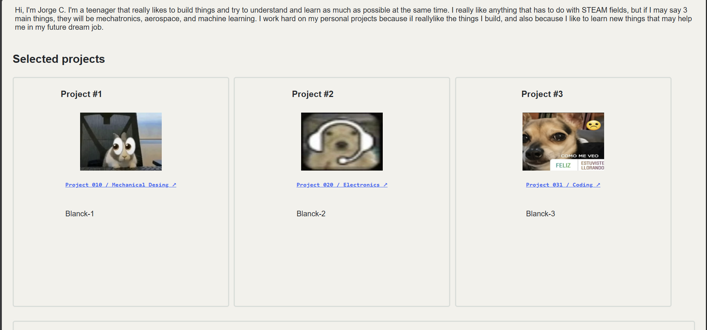
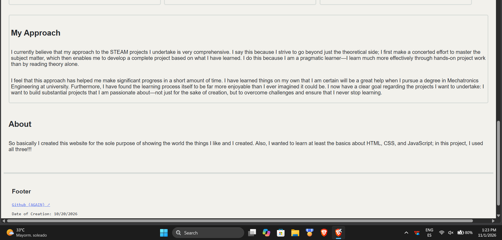
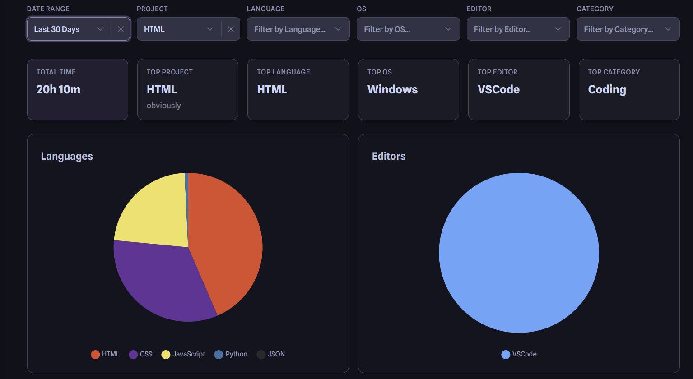

<h1>Personal Portfolio</h1>
 

<h2>What im working on?</h2>
 

I am currently working on a personal portfolio website where I can share all the things I care about, from code to going through mechanical design and electronics. There's only one thing you need to know about me for this project. I have never worked with HTML nor CSS before. I wanted a scalable and useful project. And because of that, I created an "art portfolio." 

<h2>How to run/try</h2>
 

Right now there's no public way in which you can try it completely, because i dont have a permanent public domain and it need to have some changes. But don't worry, there's still some solution! 

First solution: Try the demo! It isn't completely working, but still something. <a href='https://staticfile-5fabd.wasmer.app/index.html'>(Click here↗)</a>

Second solution: Try downloading the files from the Webpage-demo folder from this repo. Being honest, idk if it works like that; I haven't tried it yet, but you should try it if you want a more complete experience.

<h2>Latest update</h2>
 

The latest thing that I have been working on in this project is the sorting system in the project's files. I also fixed all the links that matter rn. And finally, I add some personal text; before, I just had dummy text.

<h2>Extra photos</h2>
 

